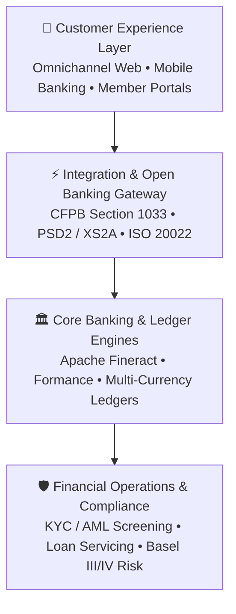

  

<h1 align="center">🏦 Awesome Financial Services Experience Platform 💳</h1>

  <strong>Curated ecosystem of SaaS suites, open-source core banking engines, digital banking frontends, self-hosted financial CRMs, and API ledgers.</strong>

  
  
  
  
  
  

---

## 📌 Overview & Scope

This repository tracks notable **commercial SaaS platforms** and **active open-source projects** powering the **Financial Services Experience Platform** ecosystem. These platforms provide the mission-critical digital infrastructure for retail banks, credit unions, community banks, neobanks, and commercial lenders:

- **🏛️ Core Banking Ledgers**: Double-entry bookkeeping, account lifecycle, multi-currency deposits, and automated loan amortization.
- **📱 Digital Banking Frontends**: Responsive web portals and iOS/Android mobile apps for customer self-service onboarding and account management.
- **⚡ Open Banking & Payments**: Seamless compliance with CFPB Section 1033, PSD2/XS2A, ISO 20022 messaging, and real-time FedNow/ACH rails.
- **🤝 Financial CRM & Loan Origination**: Vertical-specific borrower relationship mapping, credit decisioning, and compliance auditing.

---

## 📑 Table of Contents

- [🌐 Sector Overview & Market Dynamics](#-sector-overview--market-dynamics)
- [🏢 SaaS & Hosted Commercial Platforms](#-saas--hosted-commercial-platforms)
- [💻 Open-Source GitHub Projects](#-open-source-github-projects)
  - [⭐ Featured Open-Source Projects (Sorted by Stars)](#-featured-open-source-projects-sorted-by-stars)
  - [🏛️ Core Banking Engines & Programmable Ledgers](#️-core-banking-engines--programmable-ledgers)
  - [📱 Digital Banking Frontends & Mobile Apps](#-digital-banking-frontends--mobile-apps)
  - [🤝 Financial CRM & Loan Management](#-financial-crm--loan-management)
  - [📈 Wealth Management & Financial Analytics](#-wealth-management--financial-analytics)
- [🏷️ Topics & Search Keywords](#️-topics--search-keywords)
- [🤝 How to Contribute](#-how-to-contribute)
- [💖 Support & Sponsorship](#-support--sponsorship)
- [📈 Star History](#--star-history)
- [📜 Disclaimer](#-disclaimer)

---

## 🌐 Sector Overview & Market Dynamics

- **Market Size**: The global Financial Services Experience Platform and digital banking software market was valued at **$14.2 Billion in 2024–2025** and is projected to expand to **$38.5+ Billion by 2032**, growing at a compound annual growth rate (**CAGR of ~14.5%**).
- **Market Dynamics & Fragmentation**: The sector exhibits a **bifurcated, moderately concentrated structure** shaped by stringent regulatory barriers and high switching costs. The underlying **core banking ledger and accounting layer is highly concentrated**—dominated by established enterprise incumbents (Fiserv, Temenos, FIS, Finastra) with multi-year contract retention rates exceeding 95% due to high migration risks. In contrast, the **digital experience, customer engagement, and workflow layer is moderately fragmented**, featuring active competition between enterprise engagement suites (Backbase, Q2, Alkami, Salesforce Financial Services Cloud) and emerging open-source platforms designed to disaggregate legacy vendor lock-in.

---

## 🏢 SaaS & Hosted Commercial Platforms

The following enterprise platforms deliver turnkey core banking, loan origination, omnichannel customer portals, and financial relationship management.

> *Sorted descending by company size (Valuation / Market Cap / Revenue).*

| Product | Company Size & Valuation | Core Focus & Platform Capabilities | Starting Pricing | Free Tier / Free Trial Limits |
| :--- | :--- | :--- | :--- | :--- |
| **[Salesforce Financial Services Cloud](https://www.salesforce.com/solutions/industries/financial-services/financial-services-cloud/)** | **~$310B+** Market Cap (NYSE: CRM) • **~$38B+** Annual Revenue | Enterprise relationship management, wealth management, retail banking CRM, household financial account mapping, and loan referral tracking. | Starting at **$325/user/month** (Enterprise Edition billed annually; Starter edition starts from **$225/user/month**) | **30-day free trial** of pre-configured Financial Services Cloud org with sample client accounts, financial goals, and wealth dashboards (up to 2 test orgs; no credit card required). |
| **[Adobe Financial Services Cloud](https://business.adobe.com/industries/financial-services.html)** | **~$210B+** Market Cap (NASDAQ: ADBE) • **~$21.5B+** Annual Revenue | Omnichannel digital banking customer experience, personalized portal content management (AEM), real-time customer data platform (CDP), and secure onboarding workflows. | Foundational Experience Cloud packages starting at **~$1,500/month** (~$18,000/year base commitment for regional institutions; Document Cloud workflows from **$14.99/user/month**) | **14-day free trial** for Document Cloud banking workflows (up to 100 agreement transactions); **30-day guided sandbox access** for Experience Cloud upon partner engagement. |
| **[Fiserv DNA](https://www.fiserv.com/)** | **~$85B+** Market Cap (NYSE: FI) • **~$19.3B+** Annual Revenue | Real-time, relational core account processing platform for retail banks, commercial institutions, and credit unions, with 24x7 continuous real-time ledger updates. | Core processing modular contracts starting at **~$2,500/month** (~$30,000/year base platform subscription for community credit unions plus ~$0.18–$0.45 per active account/month) | **30-day developer sandbox access** via Finxact / Fiserv Developer Portal with preloaded mock retail ledger datasets and up to 5,000 sandbox test API calls. |
| **[Temenos Cloud](https://www.temenos.com/)** | **~$5.5B** Market Cap (SIX: TEMN) • **~$1.05B+** Annual Revenue | End-to-end composable core banking, payments engine, deposits, and multi-currency treasury suite for universal banks, neobanks, and credit unions. | SaaS foundational core banking packages starting at **~$4,166/month** (~$50,000/year base tier for challenger institutions on AWS/Azure plus ~$0.20–$0.40 per active account/month) | **30-day free trial** of Temenos Developer Sandbox with pre-configured core banking environments, sandbox API keys, and up to 10,000 mock transaction API calls. |
| **[Q2 Digital Banking](https://www.q2.com/)** | **~$5.2B** Market Cap (NYSE: QTWO) • **~$690M+** Annual Revenue | Comprehensive digital engagement platform connecting retail, commercial, and SMB banking accounts with single-sign-on, fraud mitigation, and fintech integrations. | Base digital banking platform tier starting at **~$4,500/month** (~$54,000/year minimum platform license for community financial institutions plus ~$1.25/active digital user/month) | **30-day evaluation access** to Q2 Innovation Studio SDK and developer portal with synthetic core banking test feeds and up to 2,500 test transactions. |
| **[nCino Bank Operating System](https://www.ncino.com/)** | **~$4.2B** Market Cap (NASDAQ: NCNO) • **~$520M+** Annual Revenue | Cloud banking operating system built on Salesforce, automating commercial loan origination, retail onboarding, portfolio analytics, and credit risk workflows. | Commercial and small business lending modules starting at **~$175/user/month** (minimum departmental subscription starting at **~$1,750/month** / $21,000/year billed annually) | **30-day sandbox trial** with sample commercial loan pipeline templates, automated credit decisioning rules, and up to 5 evaluation user seats. |
| **[Alkami Technology](https://www.alkami.com/)** | **~$3.6B** Market Cap (NASDAQ: ALKT) • **~$330M+** Annual Revenue | Cloud-native digital banking platform delivering mobile banking, financial wellness, ACH/wire transfers, and data analytics for credit unions and community banks. | Base digital banking cloud subscription starting at **~$3,750/month** (~$45,000/year entry tier for credit unions plus ~$1.10–$1.85 per registered mobile/online banking user/month) | **30-day developer evaluation portal access** with simulated retail/business banking accounts and mock payment gateway endpoints. |
| **[Finastra Fusion](https://www.finastra.com/)** | **~$3.0B** Valuation (Vista Equity Partners) • **~$1.9B+** Annual Revenue | Universal banking, lending, treasury, and open banking platform connecting financial institutions to the FusionFabric.cloud app ecosystem. | Fusion core / lending module starting packages starting at **~$3,500/month** (~$42,000/year base tier for community lenders plus per-active-loan volume fees) | **30-day free developer access** on FusionFabric.cloud with access to 200+ OpenAPI banking endpoints and 2,500 mock sandbox requests. |
| **[Backbase Engagement Banking](https://www.backbase.com/)** | **~$2.7B** Valuation (€2.5B, Motive Partners) • **~$260M+** Annual Revenue | Customer engagement banking platform unifying customer onboarding, web/mobile retail banking, and employee frontends on top of legacy core ledgers. | Backbase-as-a-Service (BaaS) foundational packages starting at **~$5,000/month** (~$60,000/year baseline subscription plus ~$0.25/active customer/year) | **30-day private developer sandbox evaluation** with Backbase Design System UI components, sample retail customer journeys, and mock core ledger connectors. |

---

## 💻 Open-Source GitHub Projects

Explore the leading open-source repositories powering self-hosted core banking engines, client portals, programmable ledgers, lending management, and financial analytics.

> *Sorted descending by GitHub Star count.*

### ⭐ Featured Open-Source Projects (Sorted by Stars)

- **[Maybe](https://github.com/maybe-finance/maybe)**   
  The personal finance OS. Self-hosted platform for tracking investment portfolios, multi-currency accounts, cash flows, and personal wealth analytics. Built with Ruby on Rails and modern web standards.

- **[Actual Budget](https://github.com/actualbudget/actual)**   
  Super-fast, privacy-focused, zero-based budgeting engine built with local-first SQLite and end-to-end encryption. Provides financial account synchronization, multi-device management, and automated bank transaction imports.

- **[Firefly III](https://github.com/firefly-iii/firefly-iii)**   
  Self-hosted financial manager utilizing formal double-entry bookkeeping principles. Features automated transaction rule engines, recurring bill tracking, multi-currency budgeting, and RESTful API endpoints.

- **[Perspective](https://github.com/perspective-dev/perspective)**   
  High-performance interactive streaming data visualization engine for financial analytics originally developed by J.P. Morgan and governed by FINOS. Powers real-time trading desks, risk analytics heatmaps, and transaction monitoring dashboards.

- **[Ghostfolio](https://github.com/ghostfolio/ghostfolio)**   
  Open-source, privacy-first wealth management platform for tracking multi-asset portfolios (stocks, ETFs, cryptocurrencies, cash). AGPL-3.0 licensed with portfolio performance analytics and self-hosted data sovereignty.

- **[Kill Bill](https://github.com/killbill/killbill)**   
  Open-source subscription billing and payments platform architected for financial infrastructure. Provides complex rating, invoice generation, payment gateway routing, and financial accounting ledgers.

- **[Rotki](https://github.com/rotki/rotki)**   
  Open-source portfolio tracking, accounting, and analytics application that respects privacy by keeping all financial data strictly encrypted on the user's local machine without third-party tracking.

- **[Apache Fineract](https://github.com/apache/fineract)**   
  The reference open-source core banking engine under the Apache Software Foundation. An API-first platform providing loan management, savings, client KYC, double-entry accounting ledgers, and payment processing. Multi-tenant architecture powering 400+ financial institutions and millions of accounts globally.

- **[Open Bank Project (OBP API)](https://github.com/OpenBankProject/OBP-API)**   
  The leading open-source RESTful API middleware platform for banks. Provides out-of-the-box support for Open Banking, PSD2, XS2A, accounts, transactions, KYC, counterparties, payments, and fine-grained entitlement metadata.

- **[Formance Ledger](https://github.com/formancehq/ledger)**   
  Programmable double-entry financial ledger purpose-built for fintechs and financial platforms. Tracks money movements across accounts, payment rails, and multi-currency balances with a dedicated DSL (Numscript) and transactional integrity.

- **[Moov ACH](https://github.com/moov-io/ach)**   
  Open-source financial protocol engine written in Go for parsing, validating, and generating NACHA ACH payment files. Bridges cloud fintech platforms with US banking clearing houses and FedNow payment rails.

- **[Mifos X Web App](https://github.com/openMF/web-app)**   
  The Angular-based web client for the Mifos X and Apache Fineract core banking platform. Equips branch staff, loan officers, and financial administrators with back-office operations, client management, and accounting dashboards.

- **[Mifos Mobile](https://github.com/openMF/mifos-mobile)**   
  Open-source Android mobile banking client designed for financial institutions operating on Apache Fineract. Enables account balance inquiries, loan repayment schedules, inter-account transfers, and mobile self-service.

- **[Frappe Lending](https://github.com/frappe/lending)**   
  Open-source loan management system (LMS) built on Frappe and ERPNext. Covers the complete loan lifecycle from borrower origination to disbursement, repayment tracking, automated penalty billing, and NPA classification.

- **[FINOS FDC3](https://github.com/finos/FDC3)**   
  The Financial Desktop Connectivity and Consensus (FDC3) standard governed by the Fintech Open Source Foundation (FINOS). Establishes universal interoperability standards for financial desktop applications and cross-app context sharing.

- **[FinAegis](https://github.com/FinAegis/core-banking-prototype-laravel)**   
  Domain-driven core banking prototype with 61 DDD modules, event sourcing, CQRS, and schema-first GraphQL API. Supports multi-asset accounts, foreign exchange, lending, machine payments, and non-custodial wallet backends on Laravel 12.

- **[FinCRM](https://github.com/MrXujiang/FinCRM)**   
  Out-of-the-box financial CRM and office management system built with Next.js. Tailored for loan agencies and wealth managers with deal pipelines, client portfolio management, and self-hosted client portals.

- **[Fiducia](https://github.com/danweis07/Fiducia)**   
  Open-source multi-tenant digital banking framework for credit unions and community banks. Ships with consumer/business banking modules, CFPB Section 1033 consent management, ISO 20022 message compliance, and pluggable core adapters.

- **[TPT Banking](https://github.com/tpt-solutions/tpt-banking)**   
  Enterprise-grade open-source banking monorepo using NestJS microservices, PostgreSQL, Kafka, and Casbin RBAC. Covers retail banking, KYC/AML compliance, Basel III/IV regulatory reporting, and PSD2 open banking APIs.

---

### 🏛️ Core Banking Engines & Programmable Ledgers

- **[Apache Fineract](https://github.com/apache/fineract)**  — Multi-tenant core banking engine with isolated databases per tenant, REST APIs, and accounting ledgers.
- **[Formance Ledger](https://github.com/formancehq/ledger)**  — Programmable double-entry ledger for money movements, multi-currency routing, and fintech ledgers.
- **[Open Bank Project (OBP API)](https://github.com/OpenBankProject/OBP-API)**  — API middleware layer for core banking interoperability, PSD2 compliance, and financial data sharing.
- **[Moov ACH](https://github.com/moov-io/ach)**  — High-throughput Go NACHA engine for Automated Clearing House validation and payment files.
- **[FinAegis](https://github.com/FinAegis/core-banking-prototype-laravel)**  — CQRS/Event Sourcing core banking architecture prototype on Laravel 12.
- **[TPT Banking](https://github.com/tpt-solutions/tpt-banking)**  — NestJS microservices architecture for full-stack core banking and compliance.

### 📱 Digital Banking Frontends & Mobile Apps

- **[Mifos X Web App](https://github.com/openMF/web-app)**  — Official web client for staff operations, branch management, and client onboarding.
- **[Mifos Mobile](https://github.com/openMF/mifos-mobile)**  — Android digital banking app for credit unions and microfinance institutions.
- **[Fiducia](https://github.com/danweis07/Fiducia)**  — Open-source digital banking frontend with CFPB 1033 consent management and ISO 20022 schemas.

### 🤝 Financial CRM & Loan Management

- **[Frappe Lending](https://github.com/frappe/lending)**  — Open-source loan management system for NBFCs and digital lenders.
- **[FinCRM](https://github.com/MrXujiang/FinCRM)**  — Financial services CRM module for deal tracking and customer relations.

### 📈 Wealth Management & Financial Analytics

- **[Maybe](https://github.com/maybe-finance/maybe)**  — Open-source personal finance and wealth management OS.
- **[Actual Budget](https://github.com/actualbudget/actual)**  — Local-first, zero-based privacy-focused budgeting software.
- **[Firefly III](https://github.com/firefly-iii/firefly-iii)**  — Double-entry personal finance and financial account manager.
- **[Perspective](https://github.com/perspective-dev/perspective)**  — Streaming data visualization engine for financial analytics and real-time trading desks.
- **[Ghostfolio](https://github.com/ghostfolio/ghostfolio)**  — Multi-asset wealth management and portfolio performance tracker.
- **[Rotki](https://github.com/rotki/rotki)**  — Privacy-respecting portfolio tracker and crypto/traditional asset accountant.
- **[Kill Bill](https://github.com/killbill/killbill)**  — Scalable open-source billing and recurring payments engine.
- **[FINOS FDC3](https://github.com/finos/FDC3)**  — Standardized financial desktop interoperability specification.

---

## 🏷️ Topics & Search Keywords

`core-banking` • `digital-banking` • `financial-services` • `fintech` • `open-banking` • `banking-as-a-service` • `baas` • `double-entry-ledger` • `apache-fineract` • `mifos` • `loan-origination` • `financial-crm` • `psd2` • `cfpb-1033` • `iso-20022` • `wealth-management` • `payment-orchestration` • `neobanks` • `credit-unions`

---

## 🤝 How to Contribute

1. Fork the repository.
2. Add or update platform entries in `README.md` following the existing format.
3. Verify that pricing and free trial details are factual and verifiable.
4. Submit a Pull Request with a brief explanation.

⭐ Star the repo if you find it helpful!

---

## 💖 Support & Sponsorship

Thank you for exploring and utilizing the **Awesome Financial Services Experience Platform** catalog! If this curated guide has saved you time or aided your fintech and core banking research, please consider supporting the project:

- ⭐ **Star** this repository on GitHub to boost discoverability.
- 🍴 **Fork** and share it with your engineering, fintech, and banking architecture teams.
- 📣 **Spread the word** across developer communities and social platforms.
- ☕ **Buy me a coffee**: Sponsor ongoing research, updates, and open-source maintenance via the [GitHub Sponsor Dashboard](https://github.com/sponsors/ishandutta2007).

Thank you for supporting open financial technology! 🙏

---

##  Star History

---

## 📜 Disclaimer

- This is a **community-curated** catalog — not exhaustive and not an individual endorsement.
- Financial services software operates under strict regulatory frameworks (Basel III/IV, CFPB Section 1033, PSD2/Open Banking, FFIEC, SOC 2 Type II). Deploying self-hosted core banking engines or payment software requires thorough independent security audits, database replication hardening, and regulatory verification before managing customer funds.
- All product names, logos, and brands are property of their respective owners.
